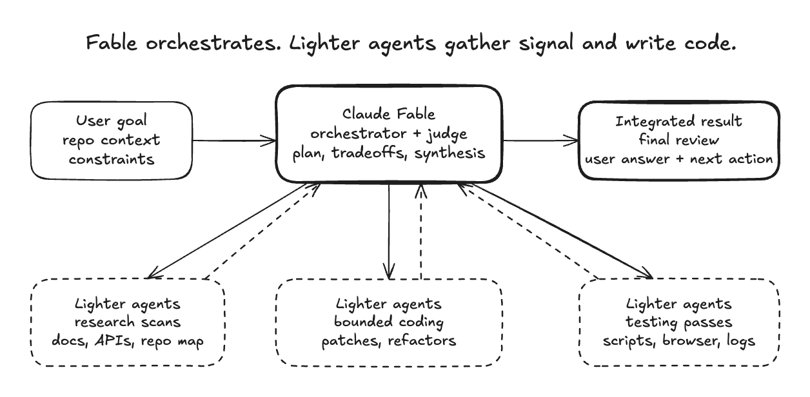

# /efficient-conductor

Teach the conductor model to delegate bounded execution to cheaper workers.

`/efficient-conductor` (formerly `efficient-fable`) is the always-on delegation
skill that makes any conductor model a coordinator rather than an executioner.
The conductor keeps the hard calls: decomposition, architecture, product
tradeoffs, synthesis, risk, final review, and advisor consultation. Workers do
the repeatable heavy passes.

<picture>
  <source media="(prefers-color-scheme: dark)" srcset="assets/fable-orchestrator-dark.png">
  <source media="(prefers-color-scheme: light)" srcset="assets/fable-orchestrator.png">
  
</picture>

## What It Does

- Splits large work into research, coding, and testing lanes.
- Routes the conductor to coordinate and judge; workers execute.
- On HEAVY tasks, enforces the advisor-gated workflow: advisor plans, conductor
  dispatches, conductor distills, advisor reviews.
- Encourages cheaper agents to scan repos, summarize docs, reduce logs, run
  browser checks, and attempt bounded patches.
- Keeps evidence flowing back to the conductor as files, commands, diffs,
  failures, and uncertainties.
- Uses self-contained handoff packets so delegated agents can work without
  hidden context from the orchestrator chat.
- Reminds the conductor to verify important delegated claims before relying on
  them.

## When To Use It

ALWAYS-ON. This skill fires automatically for any session where the conductor
is set in `settings.json`. It applies regardless of which model holds the baton.

## Testing Guidance

The conductor suggests the validation direction and names the scripts or browser
flows that matter. Lighter agents run those checks, collect screenshots,
reduce logs, and report whether failures look real, flaky, or environmental.

The point is not to outsource responsibility. The conductor still decides what
signal is trustworthy.

## Delegation Quality

Good handoffs include the repo path, exact objective, in-scope and out-of-scope
areas, expected evidence, verification commands, and stop conditions. A lighter
agent should know when to stop and report instead of widening the task on its
own.

The conductor treats delegated reports as leads. For important decisions, it
reopens the cited files or logs and checks that the evidence really supports the
claim.

## Diagram

Editable Excalidraw source:
[`assets/fable-orchestrator.excalidraw`](assets/fable-orchestrator.excalidraw)

Rendered PNGs:
[`assets/fable-orchestrator.png`](assets/fable-orchestrator.png)
and
[`assets/fable-orchestrator-dark.png`](assets/fable-orchestrator-dark.png)

## History

Renamed from `efficient-fable` to `efficient-conductor` on 2026-08-15.
The original name reflected the era when Fable 5 was always the conductor.
After the 2026-08-14 architecture switch to Opus 5 as conductor, the skill
was already model-agnostic in content; the rename makes the name match.
